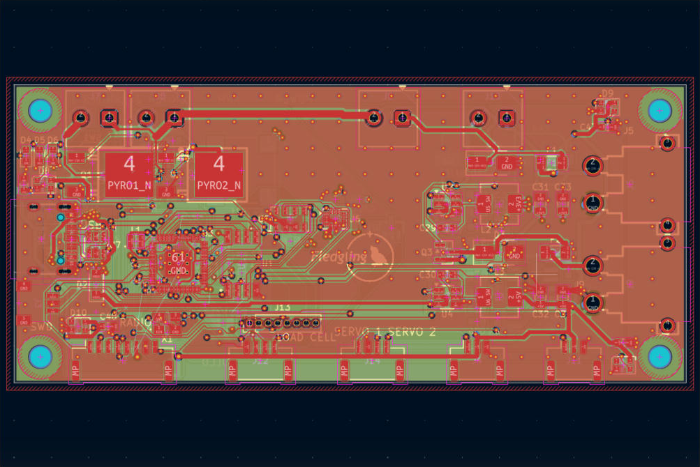
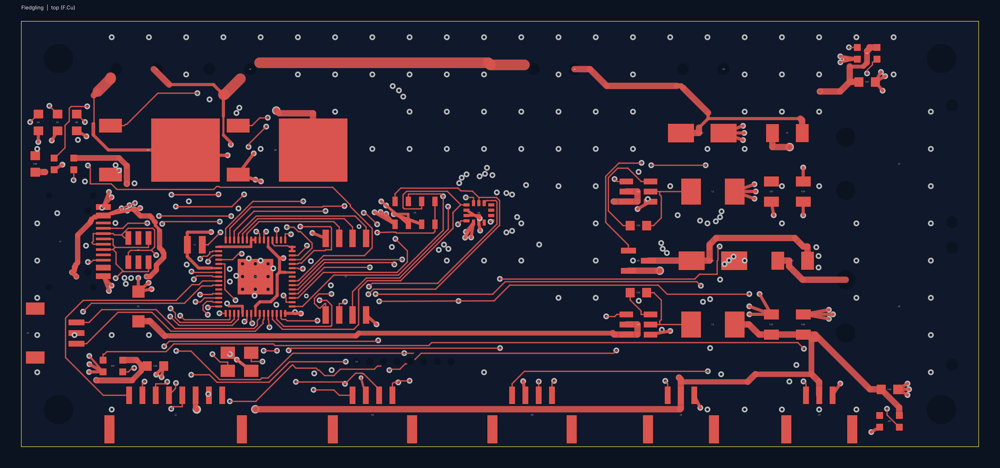
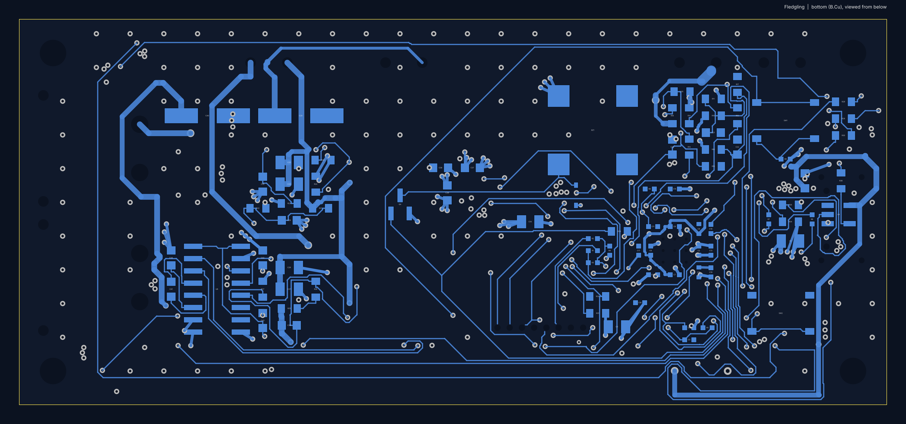
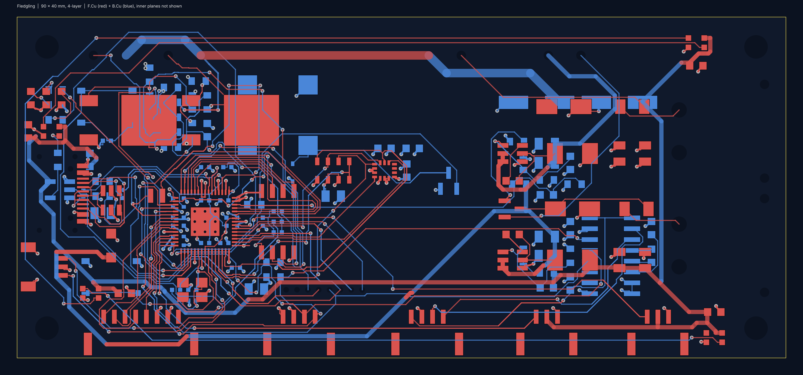

# Fledgling



> **Status: work in progress (WIP).** The schematic is drawn and the board is partly laid out, but the design is **unfinished, unrouted in places, not DRC-clean, not fabricated and not tested.** Nothing here has flown. I'm publishing it as it stands.

Fledgling is a small single-MCU flight computer for my model and high-power rockets. It's meant to be a simpler sibling of my CORVID flight computer: the same RP2350 family, IMU and power parts, so firmware and drivers carry over. It is designed to work with the [Aviary](https://github.com/Birdbrain-Aviation/aviary) software suite (Owl ground station, Heron log analysis, Mockingbird hardware-in-the-loop testing).

## Board views

These are rendered from the board file by `tools/render_board.py` (copper, pads and vias only; the inner planes are not drawn), so they are not KiCad screenshots.





## Design intent

These are the goals from my design notes, not verified results.

- Detect launch, burnout and apogee from a barometer and an IMU on one RP2350A
- Fire up to two pyro channels (deployment, backup deployment, or staged-motor ignition)
- Drive two servo outputs on a 5 V rail (airbrakes on my American Rocketry Challenge rocket)
- Log flight data to onboard flash for later analysis in Heron
- Send downlink-only telemetry over an E220 LoRa module (the rocket never receives commands)
- Report status with three LEDs, four addressable RGB LEDs and a buzzer
- Measure a load cell through a 24-bit ADC

Safety approach (as designed, unproven): pyro outputs are held off by gate pull-downs at power-up and reset, pyro has its own battery and a screw arming switch, and firmware ignores pyro until launch is detected.

## Hardware

| | |
|---|---|
| Board | 90 x 40 mm, 4 copper layers (signal / GND / +3V3 / signal), KiCad 10 |
| MCU | RP2350A, W25Q128JVSIQ 16 MB QSPI flash |
| Sensors | MS5611 barometer, LSM6DSO32 IMU, NAU7802 load-cell ADC |
| Radio | E220-900T22D LoRa module (915 MHz) on an 8-pin JST-GH cable |
| Power | Two XT30 battery inputs (main and pyro), two AP63301 buck converters (3.3 V and 5 V), reverse-polarity FET, fuses, TVS diodes |
| Outputs | 2 pyro channels (IRLR7843 low-side MOSFETs), 2 servo headers, 4x WS2812B, buzzer |
| I/O | USB-C, SWD header, I2C OLED header, load-cell header, BOOTSEL and reset buttons |

The schematic has a top-level sheet (`Fledgling.kicad_sch`) and four sub-sheets: Power, IO, Sensors and Pyro. The Pyro sheet is stored in `untitled.kicad_sch`; I left that filename alone so the sheet reference keeps working.

## Repository layout

```
hardware/   KiCad 10 project: schematic sheets, PCB, design rules
  libs/     custom footprint library (Fledgling.pretty)
bom/        parts list exported from my Google Sheet
docs/       DRC report, layout log, remaining-work list, images
tools/      script that renders the board views from the .kicad_pcb
```

Open `hardware/Fledgling.kicad_pro` in KiCad 10.

Symbols and footprints are embedded in the schematic and board files, so the design opens without the extra libraries. To edit parts you'll need the third-party libraries I used, which I haven't redistributed: Raspberry Pi's RP2350 minimal-design KiCad library (`RPI_DB`, `RPI_COMPILED`) and `easyeda2kicad`-converted parts.

## Known state (WIP)

- **2026-11-22: routing cleared for re-placement.** All traces and vias were removed so parts around the RP2350 can be moved and the board re-routed; the previous fully routed version (22 errors / 13 warnings, 22 unconnected power connections) is kept in `hardware/archive/Fledgling_routed_2026-11-21.kicad_pcb`. The DRC notes below describe that archived version.
- Last DRC run (2026-11-21, `docs/DRC-2026-11-21-j12.rpt`, with zones refilled): **22 errors and 13 warnings**. All 22 errors are unconnected power connections: the RP2350's +3V3 supply pins and its B.Cu decoupling caps have no via to the In2.Cu +3V3 plane, plus two GND and three VBUS pads and some small GND pour islands. Signal traces on both outer layers block every via spot, so the RP2350 power fan-out needs re-routing by hand. The warnings are footprint-library mismatches and one track overshoot. Silkscreen is clean. Gerbers in `fab/` are exported but marked NOT FOR FAB until the power connections are done.
- Changes on 2026-11-17: E220 supply (J2 pin 6) moved from +5V to +3V3, with the +5V trunk re-routed under J2 on B.Cu; C35/C36 feed-forward capacitor values set. See `docs/design-decisions.md`.
- Connector orientation (USB-C and XT30) checked. See `docs/layout-log-2026-11-14.md` and `docs/design-decisions.md` for the full history.
- The BOM is a draft. Some prices are optimistic LCSC "from" prices, some parts are marked pending (pyro fuse rating, load cell capacity), and a few parts have low stock. See the Status and Notes columns in `bom/Fledgling_BOM.csv`.
- Layout is incomplete and messy.
- The design has changed since my first sketches (it started as a 30 x 80 mm 2-layer board), so the early notes don't all match the current board.

## License

Not yet specified.
